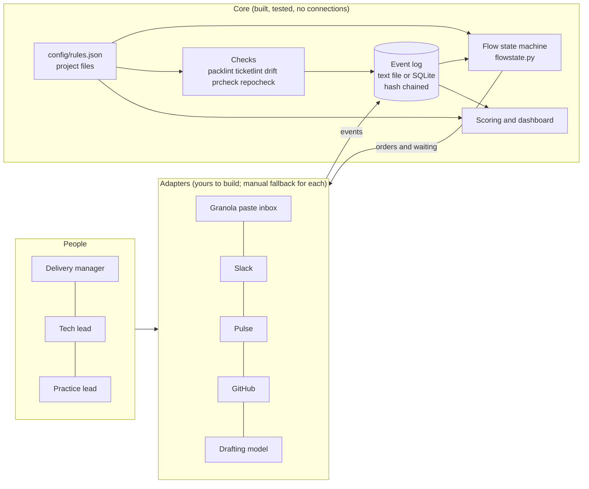

# Architecture

## The idea in one paragraph

Everything that happens is an **event** appended to a tamper-evident log. Every decision is a **pure function of that log,
the project's config and the clock**: what is due, who is being waited on, whether a gate may be approved, what the
compliance score is. Adapters (Slack, Pulse, GitHub, Granola, the drafting model) only read and write events and do the
outside-world side of an order. So the core never needs a connection, and any adapter can fail, be replaced or be done by hand
without corrupting state.



## The flow

`call pasted` -> **assess** (code) -> `draft pack` (model) -> **check pack** (code) -> *Gate 1: delivery manager, after the open questions
reached the client* -> `draft tickets` (model) -> **check tickets and drift** (code) -> **create in Pulse** -> *Gate 2: delivery manager
validates, tech lead optional* -> tier set by a lead -> branch shared -> **build brief** -> tech lead runs Claude Code -> PR with the
template and a Parakh verdict -> *Gate 3: tech lead merges, independent approver* -> release demo.
A **change request** or **follow-up call** reopens the pack: everything after it is redone against the new version, and approvals
of the old version cannot be reused (`epoch_events`).
Support requests follow the shorter support track: request -> ticket in the agreed structure -> tier -> branch or "no code".

## Modules

| File | Responsibility |
|---|---|
| `events.py` | Event types and required fields, hash-chained log, text-file and SQLite backends, `open_store`, `copy_store` |
| `flowstate.py` | **The state machine.** `next_orders(store, cfg, now)` returns orders and waiting; `can_approve`, `gate_complete`, `epoch_events` |
| `models.py` | Which steps need a model, tiers, escalation after failed checks |
| `packlint.py`, `ticketlint.py`, `drift.py` | The checks on the pack, the ticket set, and pack-vs-tickets |
| `ingest.py` | Paste-mode intake: summary refusal, dedupe, follow-up calls |
| `pulseplan.py` | Ticket set to ordered Pulse operations, resumable; change and removal notes |
| `brief.py` | Build brief; refuses unsafe branches, unready tickets, drift |
| `project.py` | Project config, validation, GitHub-flow branch rules |
| `scoring.py` | The 21 checks, disputes, metrics, compliance-to-outcome mapping |
| `tokens.py`, `tick.py` | Token accounting; the no-token tick that runs code steps itself |
| `worksheet.py` | Manual mode: every order as a checklist with exact text and commands |
| `webhooks.py`, `server.py` | GitHub and Slack webhook handling and the reference HTTP server |
| `prcheck.py`, `repocheck.py` | The required CI check and the repo readiness check |
| `dashboard.py` | Self-contained governance page |
| `cli.py`, `cli_ops.py`, `cli_extra.py` | The command line (46 commands). Thin: the logic is in the modules above |

## Data

```
projects/<KEY>.json          one file per project: people, Slack, Pulse, Git, schedules, models, storage backend
config/rules.json            every threshold, word list, role, weight and price. No code change to tune.
data/<KEY>/events.jsonl|.db  the log (never edited by hand; `dcp verify-log` proves it)
data/<KEY>/inbox/            pasted transcripts, then processed/
data/<KEY>/<flow>/           transcript.txt, pack_vN.md, tickets.md for that flow
```

## Extension points

- **New backend:** subclass `EventStore` (`_locked`, `_write_line`, `_lines`) and add it to `open_store`. `tests/test_store.py` has a contract class every backend must pass.
- **New check:** a function with `@check("C22", ...)` in `scoring.py`, an entry in `rules.json`, a test.
- **New event:** add it to `EVENT_TYPES` with its required keys.
- **New step:** add it to `ACTION_KIND` and `STEP_LABEL` in `models.py`, give it a worksheet entry (a test fails if you forget), and emit it from `flowstate.py`.
- **New lint rule:** add the finding; severity is overridable per rule in `rules.json`.

## Why events and not a database of tickets

The question the owner asked is "was the process followed, and did it help?". That is a question about **what happened and in what
order**, which only a log answers, and a log that cannot be quietly edited is what makes scoring people defensible. State is
always recomputed, so a crash, a repeated run or a manual step cannot skip or double anything.
